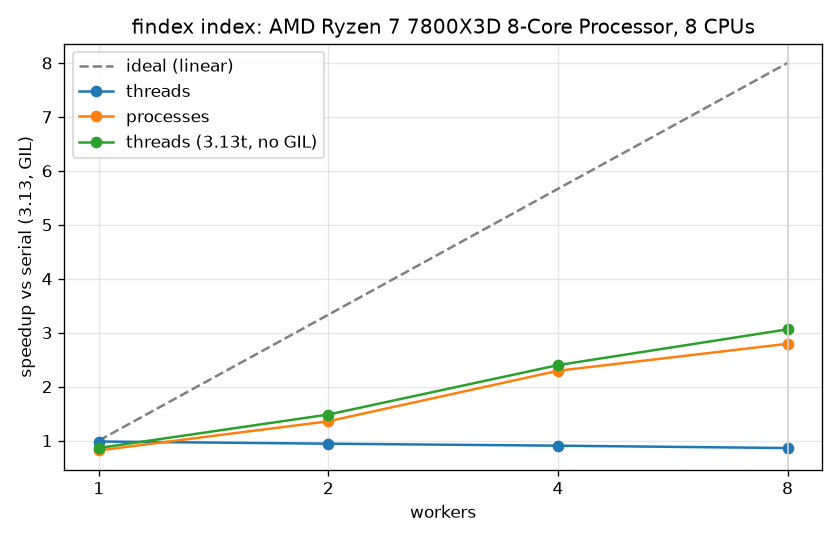

# findex

[](https://github.com/nikitavasylevskyi/findex/actions/workflows/ci.yml)

Невелика пошукова система на Python, яку я будую протягом семестру. Кожна лабораторна додає одну
особливість мови і один крок проєкту.

## Корпус

Шукаємо по документах про сам Python:

- усі **PEP** (Python Enhancement Proposals) з репозиторію [python/peps](https://github.com/python/peps) — 748 файлів;
- вихідні тексти **документації CPython** (`Doc/*.rst` з [python/cpython](https://github.com/python/cpython)) — 561 файл.

Разом 1309 документів, 26.9 МіБ тексту у форматі reStructuredText. Мені цікаво шукати саме тут: як
змінювалась мова, хто і навіщо запропонував `async`, `match`, f-рядки, і що з цього лишилось у документації.

Корпус у репозиторій не входить (`data/` у `.gitignore`), його завантажує скрипт:

```bash
uv run python scripts/fetch_corpus.py      # потрібен лише git
```

## Лаба 1 — ітератори, генератори і корпус

```bash
uv run python -m findex.stats data/            # лінивий конвеєр
uv run python -m findex.stats data/ --greedy   # усе через списки
uv run python -m unittest discover -s tests
```

- `findex.corpus.iter_documents(root)` — генератор, читає файли по одному і віддає `Document(doc_id, path, title, text)`.
  Заголовок береться з поля `Title:` у PEP або з першого підкресленого заголовка rst.
- `findex.tokenize.tokenize(text)` — генератор токенів. Правила задокументовані в модулі і перевірені тестами:
  NFKC + `casefold()`, апостроф усередині слова прибирається (`don't` → `dont`), дефіс розділяє
  (`read-only` → `read`, `only`), числа лишаються окремими токенами (`PEP 572` → `pep`, `572`),
  підкреслення всередині ідентифікатора не розриває його (`sys_path`).
- `findex.stats` рахує документи, токени, словник і топ-50 термів за один прохід.

### Вимірювання

Час — медіана трьох запусків без tracemalloc, пам'ять — пік `tracemalloc` в окремому запуску.

| Варіант | Документів | Токенів | Словник | Час, с | Пік пам'яті, МіБ |
|---|---:|---:|---:|---:|---:|
| лінивий (генератори) | 1309 | 3 917 423 | 63 693 | 1.59 | 7.1 |
| жадібний (списки) | 1309 | 3 917 423 | 63 693 | 1.60 | 268.6 |

Числа збігаються, час майже однаковий, а пам'яті жадібна версія бере у 38 разів більше.

**Куди пішла пам'ять у жадібній версії** (поетапно через `tracemalloc.get_traced_memory()`):

- тексти всіх файлів у списку — 37.1 МіБ. Більше за 26.9 МіБ на диску, бо кожен `str` має заголовок
  ~49 байт, а файли з не-ASCII символами (лапки, тире, кирилиця в прикладах) CPython зберігає по 2 байти на символ;
- списки токенів кожного документа — 194.4 МіБ. Це 3.9 млн окремих об'єктів `str` по ~46 байт
  (`sys.getsizeof` для коротких ASCII-рядків), хоча унікальних термів лише 63 тис.;
- плаский список усіх токенів — ще 33.1 МіБ: самі рядки не копіюються, але кожен елемент — вказівник на 8 байт
  плюс запас, який список тримає під майбутні `append`.

Лінивий конвеєр тримає один файл, генератор токенів і `Counter`. Пік — це, по суті, словник `Counter`
на 63 тис. ключів і найбільший окремий файл.

Перша версія лінивого підрахунку робила `counts[tok] += 1` у циклі Python і працювала 8.5 с проти 7.0 с
у жадібної (під tracemalloc). Після заміни на `counts.update(tokenize(text))` цикл по токенах іде всередині C,
а генератор не перетворюється на список — час зрівнявся з жадібною версією без втрати пам'яті.

### Топ-10 термів

`the` 208 085, `to` 90 686, `a` 90 408, `is` 69 872, `of` 67 257, `and` 62 461, `in` 57 153, `for` 45 701,
`be` 38 163, `this` 36 267. Перше специфічне слово — `python` (12-те місце), далі `class`, `function`, `pep`, `type`, `module`.

## Лаба 2 — інвертований індекс

```bash
uv run python -m findex.index data/ --out index.bin                 # бінарний формат
uv run python -m findex.index data/ --out index.pkl --format pickle --positions
uv run python -m findex.search index.bin "walrus operator NOT lambda"
uv run python -m findex.search index.bin "async await OR coroutine" --engine set
uv run python scripts/bench_lab2.py data/                           # усі таблиці нижче
```

- `findex.index.build_index` — один прохід по лінивому конвеєру з лаби 1. Документи йдуть за зростанням `doc_id`,
  тому `append` у `defaultdict(list)` одразу дає відсортовані списки постінгів.
- `Posting(doc_id, tf, positions)` і `DocMeta(doc_id, path, title, length)` — `@dataclass(frozen=True, slots=True)`.
  Позиції зберігаються лише з `--positions`.
- `findex.boolean` — запит `a b OR c NOT d` означає `(a AND b) OR (c AND NOT d)`. Двовказівникові
  `intersect` / `union` / `difference` по відсортованих списках (`--engine merge`) і та сама логіка на `set` (`--engine set`).
  Якщо один список у 8+ разів коротший, `intersect` не крокує по довгому, а стрибає по ньому `bisect_left`.
- `findex.storage` — `pickle` і власний бінарний формат: заголовок JSON (метадані документів і словник) +
  один масив `array('I')` з дельта-кодованими `doc_id`, частотами і позиціями.

**Чому `pickle.load` чужого файлу небезпечний.** Pickle — це не дані, а програма для невеликої віртуальної машини.
Об'єкт може через `__reduce__` записати «виклич `os.system` з таким-то аргументом», і `load` це виконає.
Тому `storage.load` відкриває pickle лише для файлів, які зібрав сам; бінарний формат читає тільки числа і рядки.

### Пам'ять трьох варіантів постінгів

837 394 постінги (пари `doc_id`, `tf`) на 63 693 термах, приріст `tracemalloc` при побудові словника постінгів:

| Зберігання | МіБ | байт на постінг |
|---|---:|---:|
| `@dataclass` | 83.5 | 104.5 |
| `@dataclass(slots=True)` | 51.5 | 64.5 |
| пари в `array('I')` | 13.1 | 16.4 |

Куди йдуть байти. Звичайний екземпляр dataclass — це об'єкт із заголовком (16 байт), вказівником на `__dict__`
і сам `__dict__` з двома ключами (ключі спільні для всіх екземплярів, але таблиця значень своя) — близько 96 байт,
плюс 8 байт вказівника в списку. `slots=True` прибирає `__dict__`: лишається заголовок і два слоти по 8 байт,
48 байт + GC-заголовок 16 + вказівник 8 = 64. Самі числа `doc_id`/`tf` до 256 майже не коштують — малі `int`
кешовані, більші — окремі об'єкти по 28 байт, які частково спільні. `array('I')` зберігає по 4 байти на число
без жодних об'єктів: 8 байт на пару, решта — заголовки масивів для 63 тис. термів (більшість постінгів — короткі списки).

### Збереження і завантаження

Медіана трьох запусків:

| Формат | Позиції | Файл, МіБ | save, с | load, с |
|---|---|---:|---:|---:|
| pickle | ні | 13.8 | 2.23 | 3.15 |
| бінарний | ні | 7.8 | 0.19 | 1.23 |
| pickle | так | 25.6 | 4.06 | 3.17 |
| бінарний | так | 22.8 | 0.75 | 2.56 |

Позиції роблять індекс у 2–3 рази більшим: на кожне з 3.9 млн входжень припадає ще одне число.
Бінарний файл менший за pickle, бо `doc_id` записані різницями і без імен полів; зберігається він на порядок швидше,
бо `array.tofile` пише один суцільний буфер. При завантаженні обидва формати упираються в створення сотень тисяч
об'єктів `Posting`.

### merge проти set

Запит з двох термінів, медіана 200 запусків (включно з витягуванням `doc_id` зі списків постінгів):

| Запит | df | Результат | merge, мкс | set, мкс |
|---|---|---:|---:|---:|
| `in the` (два найчастіші) | 1284 / 1301 | 1283 | 157 | 84 |
| `workshop linkcheck` (два найрідкісніші з df ≥ 2) | 2 / 2 | 1 | 4 | 3 |
| `the macosx_14_0_x86_64` (частий + рідкісний) | 1301 / 1 | 1 | 19 | 29 |

На двох довгих списках `set` швидший: побудова множини і перетин ідуть у C, а двовказівниковий цикл — це
тисячі ітерацій байт-коду Python. Зате `merge` не будує хеш-таблиць і віддає вже відсортований результат, а на
сильно різних довжинах стрибки `bisect` обходять довгий список за log n — тут він швидший за `set`, якому все одно
треба перегнати в множину всі 1301 id частого терміна.

## Лаба 3 — рейтинг і модель об'єктів

```bash
uv run python -m findex.index data/ --out index.bin --positions
uv run python -m findex.search index.bin 'python AND (async OR await) NOT java "event loop"' -k 5
uv run python -m findex.search index.bin "walrus" "walrus" --scorer tfidf    # другий раз — з кешу
uv run python scripts/eval_lab3.py index.bin                                  # перевірки і P@5
```

- `findex.index.Index` наслідує `collections.abc.Mapping`: `len(index)`, `"async" in index`, `index["async"]`,
  ітерація по термах, `repr`. `num_docs`, `avg_doc_length` (`cached_property`), `df(term)`.
- `findex.search.open_index(path)` — контекстний менеджер; у `finally` викликає `index.close()`, тож дані
  звільняються і тоді, коли всередині `with` вилетів виняток (перевіряє `test_open_index_releases_on_error`).
- `findex.ranking.Scorer` — `typing.Protocol` з `name` і `score(index, df, posting)`. `TfIdf` і `BM25(k1=1.5, b=0.75)`
  його не наслідують, а просто мають такі методи. `Searcher.search` накопичує бали в `defaultdict(float)` і бере топ-k
  через `heapq.nlargest`. Результат — `SearchResult` з `order=True`, порівнюється лише за балом.
- `findex.query` — рекурсивний спуск, по функції на правило граматики. Вузли `Term`, `Phrase`, `And`, `Or`, `Not`
  збираються і операторами `&`, `|`, `~`; `evaluate(index)` повертає відсортовані `doc_id` через merge з лаби 2.
  `Phrase` перевіряє, що позиції слів ідуть підряд, тому потребує індексу з `--positions`.
  Тести парсера порівнюють дерева: `parse("a AND NOT b OR c") == Term("a") & ~Term("b") | Term("c")`.
- `@timed` (`functools.wraps`) стоїть на `build_index`, `save`, `load`, `Searcher.search`. `Searcher.matching` —
  `lru_cache(maxsize=512)` на шлях «рядок запиту → id документів»:

```text
[timed] load: 1133.3 ms
[timed] Searcher.search: 8.9 ms
[cache] hit for 'walrus'
[timed] Searcher.search: 8.2 ms
```

Кеш прибирає розбір запиту і merge, але більшу частину з 8 мс займає читання файлів для сніпетів, тому різниця невелика.

- Сніпет — вікно ±80 символів навколо входження, у вікні якого найбільше різних слів запиту; слова запиту
  позначені `**...**`, вікно не ріже слова навпіл.

### Три перевірки рейтингу на корпусі

**1. Рідкісний термін важить більше за частий.** Один і той самий документ (PEP 572), по одному входженню:

| Термін | df | TF-IDF | BM25 |
|---|---:|---:|---:|
| `the` | 1301 | 0.01 | 0.00 |
| `python` | 1208 | 0.08 | 0.05 |
| `walrus` | 15 | 4.47 | 2.84 |

`the` трапляється майже в кожному документі, тож idf ≈ 0 — за запитом `the OR walrus` весь топ складають документи
про walrus.

**2. Двадцяте повторення майже нічого не додає.** Термін `walrus` у документі середньої довжини:

| tf | 1 | 2 | 3 | 5 | 10 | 19 | 20 |
|---|---:|---:|---:|---:|---:|---:|---:|
| BM25 | 4.44 | 6.34 | 7.39 | 8.53 | 9.65 | 10.28 | 10.32 |
| TF-IDF | 4.47 | 7.57 | 9.38 | 11.66 | 14.76 | 17.63 | 17.86 |

Перехід з 19 на 20 дає BM25 лише +0.04 (менше 0.4 %): `tf·(k1+1)/(tf+k1·…)` прямує до стелі `(k1+1)·idf`.
У TF-IDF з логарифмом той самий крок дає +0.23 — росте повільно, але без межі.

**3. Короткий документ з одним входженням вище за дуже довгий.**

| Документ | Довжина, токенів | BM25 | TF-IDF |
|---|---:|---:|---:|
| Concrete Objects Layer | 291 | 7.47 | 4.47 |
| tkinter — Python interface to Tcl/Tk | 37 461 | 0.72 | 4.47 |

BM25 ділить на нормовану довжину документа (`b = 0.75`), тому одне згадування в короткому тексті важить у 10 разів більше.
TF-IDF довжини не враховує і ставить їх нарівні.

### Precision@5: TF-IDF проти BM25

10 запитів, для кожного я вручну переглянув кандидатів і записав, які документи справді про це
(`eval/queries.json`). P@5 — частка релевантних серед перших п'яти.

| # | Запит | TF-IDF | BM25 |
|---|---|---:|---:|
| 1 | `walrus OR operator OR assignment OR expression` | 0.6 | 0.4 |
| 2 | `structural OR pattern OR matching` | 1.0 | 1.0 |
| 3 | `f-string OR formatting` | 0.6 | 1.0 |
| 4 | `type OR hints OR generics` | 0.8 | 0.8 |
| 5 | `asyncio OR event OR loop` | 1.0 | 1.0 |
| 6 | `global OR interpreter OR lock OR free OR threading` | 0.4 | 0.6 |
| 7 | `dataclasses` | 0.6 | 0.6 |
| 8 | `exception OR groups` | 0.4 | 0.4 |
| 9 | `unicode OR normalization` | 0.8 | 1.0 |
| 10 | `garbage OR collection OR reference OR counting` | 0.8 | 1.0 |
| | **середнє** | **0.70** | **0.78** |

BM25 виграє там, де TF-IDF тягне вгору довгі загальні сторінки («Built-in Types», «What's New», «Logging Cookbook»),
у яких слово просто часто повторюється. Програє BM25 на запиті 1: слова `operator` і `expression` часті, і короткі PEP
про інші оператори (`None`-coalescing, pattern matching) обходять довгий PEP 572. Запит 8 погано виходить в обох:
`groups` збігається з «Dependency Groups» у PEP про пакування — без фразового пошуку (`"exception groups"`) це не розрізнити.

## Лаба 4 — типи, тести, пакування і CLI

```bash
uv sync                                   # залежності + група dev з uv.lock
uv tool install .                         # команда findex у PATH
findex index data/ -o index.bin           # смуга прогресу rich
findex search '"pattern matching" NOT tutorial' -k 3
findex search walrus --json > results.json
findex -v search walrus                   # -v: час кожного кроку, -vv: debug (кеш тощо)
findex stats data/ --top 20
```

- **Типи.** Усе в `src/findex` анотоване; `pyright` у режимі `strict` — 0 помилок. `Scorer` — `typing.Protocol`:
  `TfIdf` і `BM25` нічого не наслідують, pyright перевіряє, що їхні `score` збігаються з протоколом. Генератори
  повертають `Iterator[...]`, рядкові параметри (`engine`, `scorer`, формат файлу) — `Literal`. Єдиний
  `# type: ignore` стоїть у `Index.__hash__ = None` з поясненням: змінний контейнер не має бути хешованим, як `dict`,
  а typeshed оголошує `__hash__` як метод.
- **Тести** — `pytest`, 80 штук: токенізатор (`parametrize`, зокрема NFKC, `casefold`, апострофи, кирилиця),
  збірка індексу на маленькому корпусі з `conftest.py`, merge-операції, парсер (порівняння дерев), обидва скорери і
  три перевірки з лаби 3, save/load у двох форматах, CLI через `typer.testing.CliRunner`. Три властивості Hypothesis
  (`tests/test_properties.py`): `load(save(index)) == index` на випадкових корпусах, постінги завжди відсортовані і
  `tf` дорівнює числу входжень, `intersect`/`union`/`difference` збігаються з операціями над `set`.
  Тест на справжньому корпусі триває понад секунду, позначений `@pytest.mark.slow` і пропускається, якщо `data/` немає.
- **Покриття — 94 %** (рядки + гілки, `pytest --cov`). Навмисно поза тестами: `__main__.py` (два рядки виклику
  `app`), `stats_greedy` (жадібна версія з лаби 1 — існує лише для порівняння пам'яті й запускається з
  `findex stats --greedy`), гілки CLI для порожньої видачі та помилок `stats`.
- **Пакування.** `pyproject.toml` описує метадані, залежності (`typer`, `rich`) і групу `dev`; `uv.lock` у
  репозиторії. `[project.scripts] findex = "findex.cli:app"` — точка входу.
- **CLI.** Команди `index`, `search`, `stats`. Результат — у stdout (`--json` — чистий JSON, його можна перенаправити),
  уся діагностика — у stderr через `logging`; логер налаштовується один раз у `findex.cli.main`. Очікувана помилка
  дає один рядок і код виходу 1:

```text
$ findex search "(walrus"
error: missing ')'
$ findex search x -i nope.bin
error: index file not found: nope.bin
```

- **CI** (`.github/workflows/ci.yml`) на кожен push і PR: `uv sync --locked`, `ruff`, `pyright`, `pytest`.
  `release.yml` ставить теги лаб і, коли у `pyproject.toml` з'являється нова версія, збирає wheel і публікує
  GitHub Release. Wheel `findex-0.4.0-py3-none-any.whl` ставиться в чисте оточення (`python -m venv` +
  `pip install`), після чого `findex --help` працює.

## Лаба 5 — конкурентність, GIL і паралельна індексація

`build_index` розділено на `build_partial` і `merge` (`src/findex/parallel.py`). Корпус ділиться на суцільні
шматки файлів, кожен шматок наперед отримує свій діапазон `doc_id`, тож часткові індекси не перетинаються, а `merge`
просто дописує постінги шматків по черзі. У воркер ідуть лише шляхи до файлів: читає їх він сам. Окремий тест
перевіряє, що `merge([build_partial(усі шляхи)])` дорівнює індексу з лаби 4, а ще один — що всі три виконавці
дають однаковий індекс.

```text
findex index data/ --workers 4 --executor processes     # типово: processes, workers = os.cpu_count()
findex index data/ -w 1 -e serial
```

- Процеси стартують методом `spawn` (однаково на Linux, macOS і Windows), тому `build_partial` — функція рівня
  модуля, а `__main__.py` викликає CLI лише під `if __name__ == "__main__"`.
- Якщо воркер падає, `future.result()` перекидає його виняток з його стеком у батьківський процес, збірка
  завершується помилкою (тест `test_worker_error_is_raised` для потоків і процесів).

### Ціна передачі через pickle

Перша версія повертала з воркера звичайний `Index` з об'єктами `Posting`, і процеси програвали навіть одному ядру:
на повному корпусі (837 тис. постінгів з позиціями) `pickle.dumps` займав 1.5 с, а `pickle.loads` у батьківському
процесі — 2.2 с, тобто приблизно стільки ж, скільки сама індексація (2.7 с). Ця частина виконується послідовно, і
весь виграш від паралельності зникав. Дві зміни:

1. `Posting` став `NamedTuple` замість frozen dataclass: створення об'єкта у 2.4 раза дешевше, pickle — у 1.7 раза.
2. Воркер повертає `PackedPostings` — для кожного терма три масиви `array('I')`: `doc_id`, `tf` і всі позиції
   підряд. Pickle масиву — це копіювання байтів (0.27 с замість 1.5 с, `loads` 0.08 с замість 2.2 с). `merge`
   склеює масиви, а `Index` розпаковує терм у список `Posting` лише тоді, коли його вперше читають. `storage.save`
   пише упаковані масиви напряму, без розпакування.

### Вимірювання

Основна машина: **AMD Ryzen 7 7800X3D, 8 ядер / 8 логічних CPU** (SMT вимкнено), 16 GB RAM, Windows 11;
Python 3.13.18 і 3.13.18t (free-threaded), обидва поставлені через `uv`. Повний корпус (1309 файлів, з позиціями).
Кожна клітинка — медіана трьох запусків, кожен запуск у новому інтерпретаторі (`scripts/bench_lab5.py`, сирі дані
в `bench/`). CPU time — час процесора батьківського процесу плюс воркерів (для процесів без їхнього старту),
RSS — пік лише батьківського процесу. Прискорення — відносно `serial` на звичайному 3.13. `os.cpu_count()` = 8,
тому стовпчик для нього збігається з 8 воркерами.

| Python | executor | workers | wall, s | CPU, s | RSS, MiB | merge, s | speedup |
|---|---|---:|---:|---:|---:|---:|---:|
| 3.13 | serial | 1 | 2.89 | 2.83 | 81 | 0.00 | 1.00× |
| 3.13 | threads | 1 | 2.94 | 2.89 | 115 | 0.05 | 0.98× |
| 3.13 | threads | 2 | 3.07 | 3.03 | 130 | 0.07 | 0.94× |
| 3.13 | threads | 4 | 3.19 | 3.30 | 149 | 0.10 | 0.91× |
| 3.13 | threads | 8 | 3.36 | 3.47 | 173 | 0.13 | 0.86× |
| 3.13 | processes | 1 | 3.54 | 3.05 | 130 | 0.05 | 0.82× |
| 3.13 | processes | 2 | 2.13 | 3.22 | 139 | 0.07 | 1.36× |
| 3.13 | processes | 4 | 1.26 | 3.28 | 156 | 0.09 | 2.29× |
| 3.13 | processes | 8 | 1.03 | 3.56 | 179 | 0.13 | 2.79× |
| 3.13t | serial | 1 | 3.24 | 3.19 | 87 | 0.00 | 0.89× |
| 3.13t | threads | 1 | 3.35 | 3.28 | 132 | 0.07 | 0.86× |
| 3.13t | threads | 2 | 1.95 | 3.44 | 151 | 0.10 | 1.48× |
| 3.13t | threads | 4 | 1.20 | 3.66 | 184 | 0.14 | 2.40× |
| 3.13t | threads | 8 | 0.94 | 4.17 | 226 | 0.19 | 3.06× |



Для порівняння ті самі заміри на машині з двома ядрами (Intel Xeon @ 2.30GHz, Linux,
`bench/lab5-gil.json`, `bench/lab5-ft.json`, графік `docs/lab5-speedup.png`): `serial` 2.41 с, найкращі
`processes ×2` 2.28 с (1.06×) і `threads ×2` на 3.13t 2.01 с (1.20×). Там 4 і 8 воркерів — переповненість, і
результат лише гіршає.

### Збірка без GIL

```text
> uv python install 3.13t
> uv venv .venv-ft --python 3.13t
> set VIRTUAL_ENV=.venv-ft && uv pip install --no-deps -e .
> .venv-ft\Scripts\python -c "import sys; print(sys.version, sys._is_gil_enabled())"
3.13.18 experimental free-threading build ... False
```

`--no-deps`, бо `typer` тягне `pydantic-core`, який під 3.13t не збирається (PyO3 підтримує free-threaded
CPython лише з 3.14). Ядро індексатора залежностей не має, тому заміри працюють.

Гонитва за даними (`scripts/race_lab5.py`): 8 потоків по 200 000 разів роблять `counter[t] += 1` у спільному
`Counter`.

```text
Python 3.13.18, sys._is_gil_enabled() = True, expected 1,600,000 increments
  shared_no_lock   1,600,000  lost 0
  shared_with_lock 1,600,000  lost 0
  own_counters     1,600,000  lost 0
Python 3.13.18, sys._is_gil_enabled() = False, expected 1,600,000 increments
  shared_no_lock     766,275  lost 833,725
  shared_with_lock 1,600,000  lost 0
  own_counters     1,600,000  lost 0
```

`counter[t] += 1` — це три кроки: прочитати значення, додати одиницю, записати назад. Якщо між читанням і записом
інший потік записав своє значення, одне з двох збільшень губиться. GIL не робить цю операцію атомарною, він лише
рідко перемикає потоки саме в цьому місці, тому під GIL втрат не видно, але гарантії немає. Без GIL потоки справді
працюють одночасно, і без блокування губиться більше половини оновлень. Два фікси: `threading.Lock` навколо
оновлення або, як у findex, нічого спільного взагалі — кожен воркер повертає свій частковий індекс, а `merge`
об'єднує їх в одному потоці.

### Чому так вийшло

**Потоки під GIL не прискорюють.** Індексація — це чистий Python-код (регулярні вирази, словники, списки), і
виконувати байткод у кожен момент може лише потік, що тримає GIL. Потоки по черзі передають його одне одному, тож
CPU time майже дорівнює wall time: працює одне ядро з восьми. Що більше потоків, то повільніше (2.94 → 3.36 с) —
додаються перемикання GIL, `merge` більшої кількості шматків і пам'ять під часткові індекси (RSS 115 → 173 MiB).

**Процеси прискорюють, але цим платять.** Кожен процес має свій інтерпретатор і свій GIL, тому воркери справді
займають різні ядра: на 8 воркерах wall time 1.03 с при CPU time 3.56 с. Плата видна в тій самій таблиці: CPU time
більший, ніж у `serial` (3.56 проти 2.83 с) — це старт восьми інтерпретаторів з імпортом findex, pickle часткових
індексів і `merge`; батьківський процес тримає всі прийняті частини (RSS 179 MiB проти 81), а кожен воркер — ще й
власну копію інтерпретатора. `processes ×1` повільніший за `serial` на 0.65 с — це фіксована ціна пулу.

**Закон Амдала.** Послідовна частина — список файлів, старт пулу, прийом результатів і `merge`, разом близько
0.65 с з 2.89. Модель `S(n) = 2.89 / (0.65 + 2.89 / n)` дає 1.38× для двох воркерів, 2.33× для чотирьох і 2.86× для
восьми — майже точно виміряні 1.36×, 2.29× і 2.79×. Навіть з нескінченною кількістю ядер більше 4.4× не буде. Час
`merge` росте з числом шматків (0.05 → 0.13 с), тож послідовна частина збільшується саме тоді, коли паралельна
зменшується. До переробки передачі (див. вище) послідовна частина була більшою за весь `serial`, і процеси
програвали за будь-якої кількості ядер.

**Що змінилось на 3.13t.** Без GIL потоки працюють паралельно: 8 потоків — 0.94 с, 3.06×, найкращий результат у
таблиці. Потокам не треба стартувати інтерпретатори і передавати частини через pickle — вони просто лежать у спільній
пам'яті, тому фіксована частина менша, ніж у процесів. Зате один потік на 3.13t повільніший на 12 % (3.24 с проти
2.89 с): без GIL інтерпретатор платить за атомарні лічильники посилань і блокування всередині словників. RSS у
потоків росте сильніше, ніж у процесів (226 MiB), бо всі часткові індекси живуть в одному процесі.

На цій машині процеси виграють у 2.8 раза, тому `--executor processes` з `--workers os.cpu_count()` — типові
значення.

## Лаба 6 — асинхронний краулер

Пакет `src/findex/crawl/`: `urls.py` (канонізація), `robots.py` (`RobotsCache`), `fetching.py` (`fetch`),
`crawler.py` (`crawl` — асинхронний генератор) і `run.py` (запис JSONL і живі лічильники для CLI).

```text
findex crawl https://peps.python.org/ -n 300 -c 20 --per-host 4 -o peps.jsonl --log crawl.log
findex index peps.jsonl -o peps.bin
findex search "structural pattern matching" -i peps.bin
```

**Що обходиться і звідки дозвіл.** Основний сайт — [peps.python.org](https://peps.python.org/), той самий
корпус PEP, що й у лабах 1–5, тільки в HTML. `https://peps.python.org/robots.txt` відповідає 404, а за RFC 9309
відсутній robots.txt означає, що обходити можна все; перший рядок `crawl.log` це фіксує:

```text
2026-11-20 00:56:35,181 findex.crawl robots https://peps.python.org: 404, allow all
```

Краулер усе одно обмежений: лише хост початкової адреси, стеля `--max-pages` (типово 200), не більше
`--per-host` (типово 4) запитів до одного хоста одночасно, `--delay` між запитами до хоста, повага до
`Crawl-delay` з robots.txt. User-Agent чесний, з адресою для зв'язку:
`findex-crawler/0.6 (student project; https://github.com/nikitavasylevskyi/findex)`.

Друге джерело — локальне дзеркало `scripts/mirror_lab6.py`: віддає `data/` як HTML-сторінки з затримкою 50 мс і з
навмисними збоями (429 з `Retry-After`, 503, сторінка, що не відповідає, петля редиректів, заборонений у robots.txt
розділ, мертве посилання). На ньому перевірено обробку збоїв, не навантажуючи нічий сервер.

**Як влаштовано.**

- `fetch` обгортає запит і читання тіла в `asyncio.timeout`, повертає `FetchResult` зі статусом, байтами, часом і
  числом спроб. Повтор лише для 429, 500/502/503/504 і таймауту, щонайбільше три рази. Пауза — exponential
  backoff із full jitter (випадкова в `[0, 0.5·2ⁿ]` с, щоб клієнти не верталися одночасно); якщо є `Retry-After`
  (секунди або HTTP-дата), чекаємо стільки, але не більше 30 с. Інші 4xx — остаточні. Петля редиректів закінчується
  на `max_redirects=5` як помилка без повтору.
- `RobotsCache` завантажує robots.txt один раз на хост; асинхронний замок на хост гарантує, що навіть двадцять
  одночасних перших запитів спричинять одне завантаження. 4xx — можна все, 5xx або мережева помилка — нічого.
- `crawl` — асинхронний генератор. Черга адрес, воркери в `TaskGroup`, один `Semaphore` на всі запити і окремий
  на хост, мінімальна пауза між стартами запитів до одного хоста. Адреса канонізується: схема й хост у нижньому
  регістрі, без порту за замовчуванням, без `#фрагмента`, без `.`/`..` і подвійних слешів, `/index.html` → `/`,
  параметри query відсортовані. Множина `seen` не дає завантажити адресу двічі; кінцеву адресу після редиректу теж
  додаємо в `seen`. Текст і посилання дістає `selectolax` (парсер lexbor), текст береться з `<main>`/`<article>`,
  якщо сторінка їх має. Коли зібрано `max_pages` сторінок або генератор закрили раніше, задача з `TaskGroup`
  скасовується (разом з усіма воркерами), а клієнт `httpx` закривається.
- `findex crawl` пише кожну сторінку в JSONL одразу, як вона прийшла; у пам'яті лише черга адрес і `seen`.
  `iter_documents` з лаби 1 читає JSONL рядок за рядком, `findex index` будує індекс уже після того, як цикл подій
  завершився. Сторінку в індексі адресовано як `peps.jsonl#<зсув рядка>`, тому сніпети читаються з того самого файлу,
  а у видачі показується URL. Під час обходу rich показує один рядок:
  `pages 187/300 │ 61.2 pages/s │ in flight 4 │ errors 0 │ queue 412 │ 3.1 s`. `crawl.log` має рядок на кожен URL.
- Тести (`tests/test_crawl.py`, 28 штук) ідуть через `httpx.MockTransport`, без мережі: канонізація,
  `Retry-After`, повтори і їх межа, відсутність повторів для 404, таймаут, петля редиректів, robots.txt (і що він
  завантажується один раз), стеля сторінок, обмеження одночасних запитів, пауза між запитами до хоста, запис
  JSONL → індекс → пошук.

### Вимірювання

Той самий початковий URL `https://peps.python.org/`, 200 сторінок, кожен запуск в окремому інтерпретаторі
(`scripts/bench_lab6.py`, дані в `bench/lab6-peps.json`). Машина — Ryzen 7 7800X3D, Windows 11, домашній інтернет.

| одночасних запитів | на хост | wall, s | сторінок/с | помилки | пік RSS, MiB |
|---:|---:|---:|---:|---:|---:|
| 1 | 1 | 36.5 | 5.5 | 0 | 63 |
| 5 | 5 | 7.8 | 25.7 | 0 | 62 |
| 20 | 20 | 1.7 | 118.6 | 0 | 63 |
| 20 | 4 | 3.6 | 55.1 | 0 | 61 |

На локальному дзеркалі (затримка 50 мс, 2-ядерний Xeon, `bench/lab6-mirror.json`) картина та сама: 33.0 с /
5.0 с / 1.2 с для 1 / 5 / 20, тобто 6.1 / 40.3 / 166.3 сторінки за секунду; там помилки — це навмисні 404, петля і
таймаут.

Запуск із `-vv` вмикає режим налагодження asyncio з `slow_callback_duration = 50 мс`: за весь обхід 100 сторінок
у журналі немає жодного рядка `Executing … took`, тобто жоден крок не тримав цикл подій довше 50 мс.

### Чому так

**Чому 20 запитів в одному потоці швидші за підхід лаби 5.** Сторінка peps.python.org приходить за 40–80 мс, а
розбір HTML і запис рядка JSONL займають частки мілісекунди. Майже весь час запит просто чекає на мережу, і в цей
час процесор вільний. Цикл подій тримає 20 відкритих з'єднань і просто обробляє ту відповідь, яка прийшла першою —
20 одночасних запитів дали прискорення в 21.6 раза на одному ядрі, а пам'ять не змінилася (63 MiB). Пул процесів з
лаби 5 тут лише заважав би: кожен процес — це окремий інтерпретатор (≈0.1–0.3 с старту і десятки MiB), окремий пул
з'єднань без спільного TLS і спільних `seen`/`robots`, а кожну сторінку довелося б передавати через pickle. Процеси
допомагають, коли бракує ядер; тут бракує не ядер, а одночасних очікувань, і їх дешевше тримати корутинами.

**Чого коштує ліміт на хост і навіщо він лишився.** Увесь обхід — один хост, тому `--per-host 4` перетворює 20
одночасних запитів на 4: 3.6 с замість 1.7 с, удвічі повільніше. Ліміт залишився, бо швидкість тут — за рахунок
чужого сервера: 20 паралельних запитів від одного клієнта легко виглядають як атака, сайт відповідає 429 або
блокує адресу, а для маленького сайту без CDN це справжнє навантаження. Глобальний семафор обмежує нас (сокети,
пам'ять), ліміт на хост — захищає сайт; при обході кількох хостів він не заважає загальній швидкості.

**Де зупинився б цикл подій.** Якщо викликати `build_index` всередині корутини, цикл подій не зможе запустити жодну
іншу задачу, доки індексація не закінчиться: не відповідатимуть сокети, не спрацюють таймаути, не оновляться
лічильники. `python scripts/bench_lab6.py --blocking-demo data` показує це: задача, що має «тікати» кожні 0.1 с,
отримує паузу 3.6 с, а asyncio в режимі налагодження пише:

```text
WARNING asyncio: Executing <Task pending name='Task-1' coro=<blocking_demo.<locals>.main() running at
  scripts/bench_lab6.py:80> ...> took 3.573 seconds
ticker: expected 0.1 s between ticks, got 3.62 s
```

Тому `findex index` запускається окремою командою після обходу; якщо індексувати під час обходу, роботу треба
віддати в `asyncio.to_thread` або в пул процесів з лаби 5.

### Оброблені збої

Обхід дзеркала (`findex crawl http://127.0.0.1:8765/ -n 500 -c 5 --per-host 5 --timeout 2`), рядки з
`crawl.log`:

```text
22:51:22,339 findex.crawl robots http://127.0.0.1:8765: 200, rules
22:51:22,408 findex.crawl.status ROBOTS http://127.0.0.1:8765/private/secret.html
22:51:22,465 findex.crawl.status 404 http://127.0.0.1:8765/peps/pep-9999.html 116 B 57 ms attempts=1
22:51:22,717 findex.crawl.status ERR http://127.0.0.1:8765/loop/a 0 B 310 ms attempts=1 redirect loop
22:51:23,114 findex.crawl retry http://127.0.0.1:8765/peps/pep-0205.html: 503 (attempt 1)
22:51:23,309 findex.crawl retry http://127.0.0.1:8765/peps/pep-0205.html: 503 (attempt 2)
22:51:23,646 findex.crawl retry http://127.0.0.1:8765/peps/pep-0222.html: 429, Retry-After 1.0 s (attempt 1)
22:51:24,140 findex.crawl.status 200 http://127.0.0.1:8765/peps/pep-0205.html 19683 B 1117 ms attempts=3
22:51:24,409 findex.crawl retry http://127.0.0.1:8765/peps/pep-0666.html: timeout after 2.0 s (attempt 1)
22:51:24,698 findex.crawl.status 200 http://127.0.0.1:8765/peps/pep-0222.html 9157 B 1144 ms attempts=2
22:51:26,869 findex.crawl retry http://127.0.0.1:8765/peps/pep-0666.html: timeout after 2.0 s (attempt 2)
22:51:29,338 findex.crawl retry http://127.0.0.1:8765/peps/pep-0666.html: timeout after 2.0 s (attempt 3)
22:51:33,227 findex.crawl.status ERR http://127.0.0.1:8765/peps/pep-0666.html 0 B 10819 ms attempts=4 timeout
```

Тут видно всі гілки: заборонену robots.txt адресу не запитано зовсім; 404 не повторюється; петля редиректів
обривається після п'яти переходів; 503 двічі повторено з паузами backoff із jitter, третя спроба успішна;
на 429 краулер чекав рівно `Retry-After: 1` і отримав сторінку з другої спроби; сторінка, що не відповідає,
отримала чотири спроби по 2 с з паузами між ними і записана як помилка `timeout`, а решта обходу тим часом
продовжувалась (між рядками PEP 666 — сотні інших сторінок).

Пошук по зібраному з peps.python.org індексу (300 сторінок):

```text
$ findex search "structural pattern matching" -i peps.bin -k 5
1  14.17  PEP 635 – Structural Pattern Matching: Motivation and Rationale | peps.python.org
2  12.36  PEP 636 – Structural Pattern Matching: Tutorial | peps.python.org
3  10.16  Numerical Index | peps.python.org
4  10.04  PEP 619 – Python 3.10 Release Schedule | peps.python.org
5   9.17  PEP 0 – Index of Python Enhancement Proposals (PEPs) | peps.python.org
```
